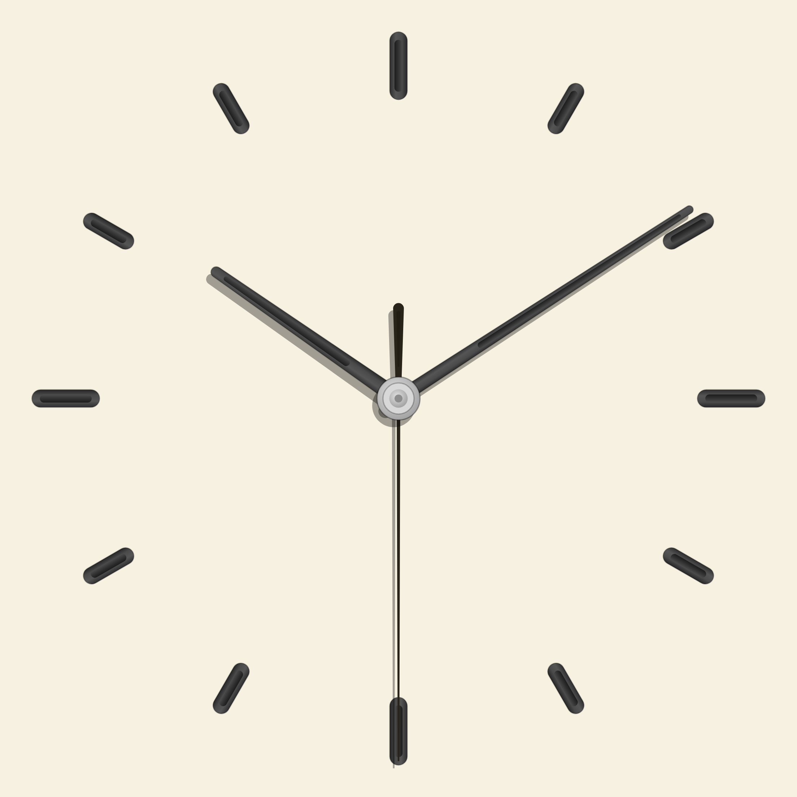
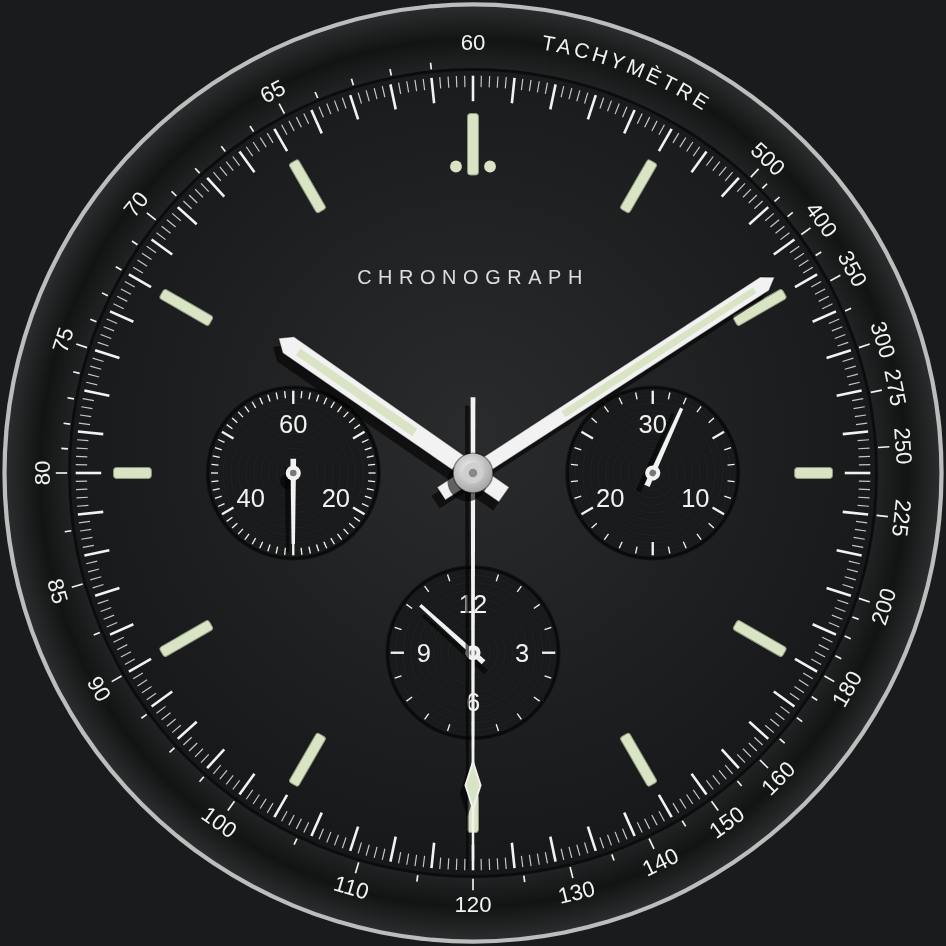
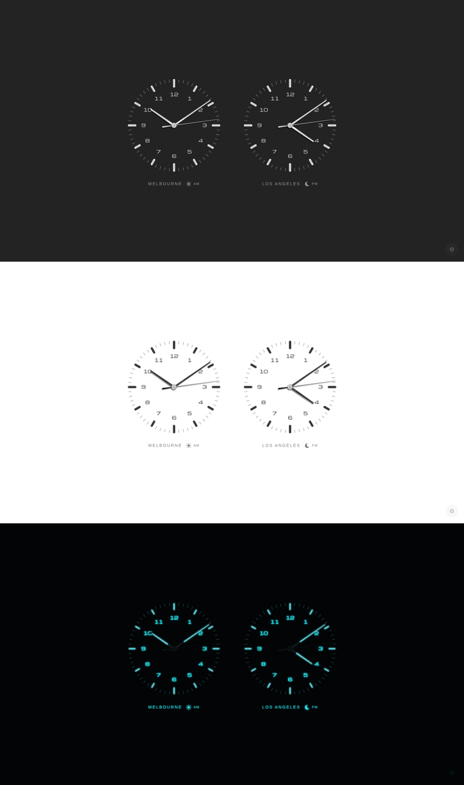
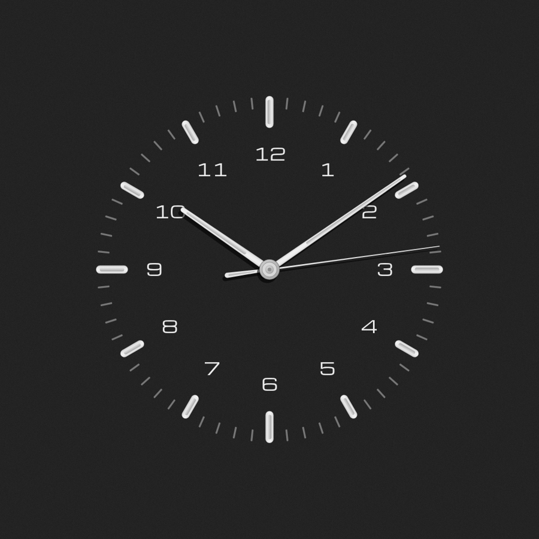
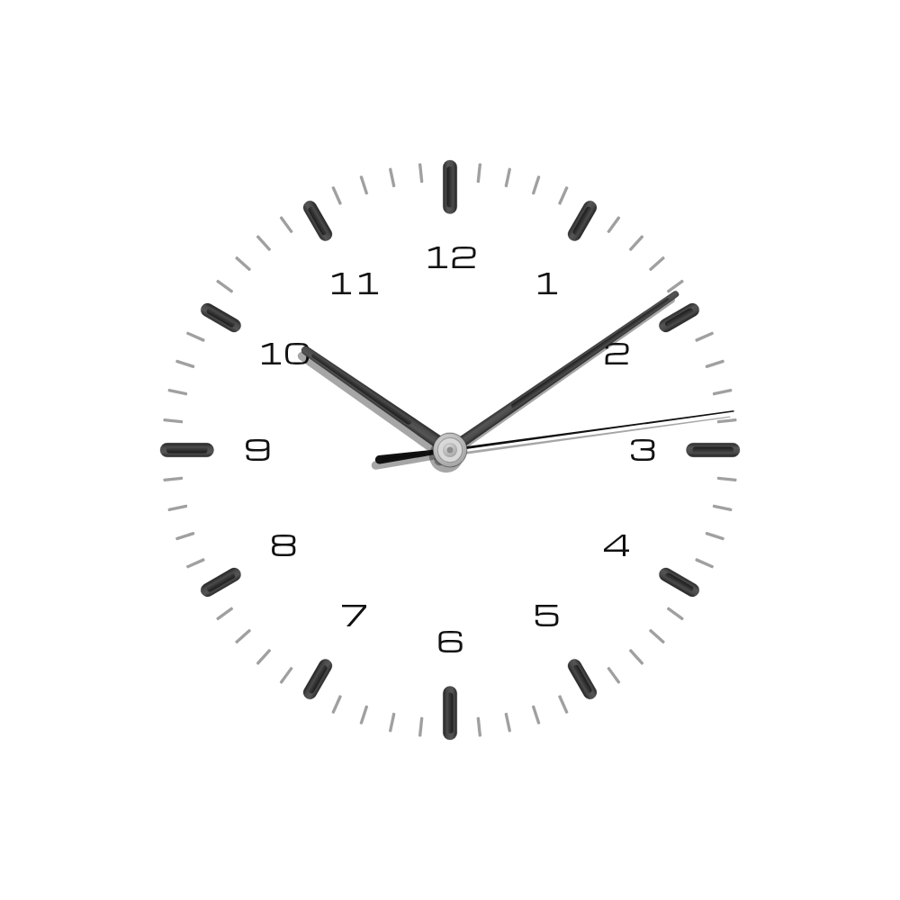
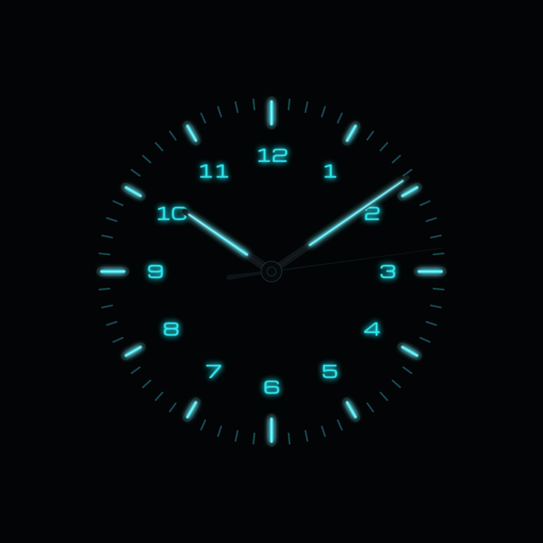
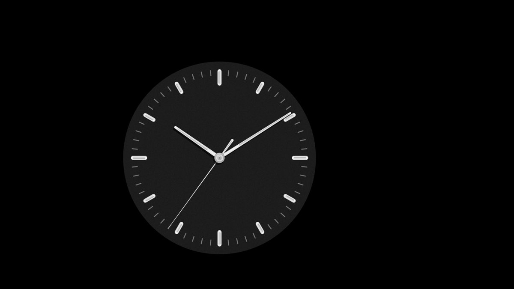
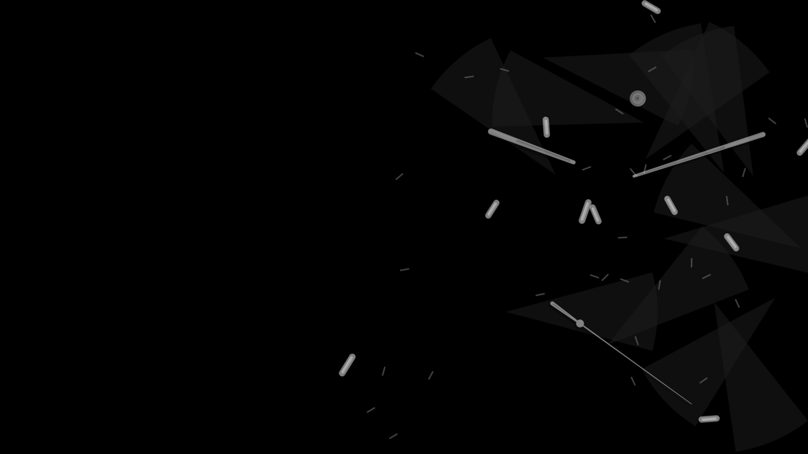
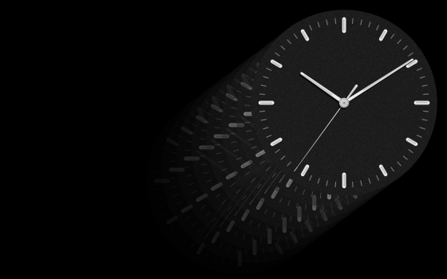
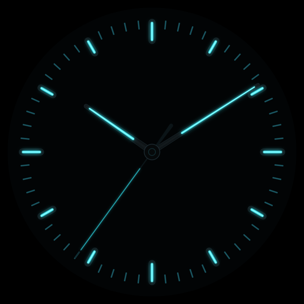

# Bauhaus Clock

<p align="center">

</p>

A minimal Bauhaus-style analogue clock in two forms:

- **Web clock** (`web/index.html`): one self-contained offline HTML file (SVG, embedded font, no network).
  [Live demo](https://clogwog.net/projects/clock/)
- **macOS screensaver** (`screensaver/`): native Swift / Core Graphics `.saver` that bounces DVD-style,
  explodes on a corner hit, respawns in a new colour and dims at night.

## Platform support

The screensaver is macOS only (macOS 13 Ventura or later, Apple Silicon and Intel; it's a native `.saver` bundle) and won't run on Windows or Linux. The web clock works in any modern browser on any device.

## Features

### Web clock

- 17 dial colours (Noir is the default).
- Speedmaster: a black chronograph dial with a tachymètre bezel, lume batons, and three subdials. The seconds subdial at 9 runs; the subdials at 3 and 6 are decorative.

  
- Three movements. Quartz ticks with a slight overshoot, Mechanical steps at eight beats a second, and Digital sweeps the seconds hand smoothly (Digital is the default). Hour and minute hands sweep on every movement.
- Classic and Compact layouts (Classic is the default; Compact leaves out the minute ticks).
- 10 languages.
- Subtle matte Bauhaus style, with grooved hour bars and slim tapered hands.
- Crisp hand shadows lit from the top-right. Multiply blending darkens whatever they fall on. Lume hides the shadows.
- Lume mode: cyan glow on a black dial.
- Optional hour numerals and seconds hand (both on by default).
- Size slider.
- Dual clock with a second time zone. Each location label is followed by a small sun and AM, or a crescent moon and PM, for that clock's time zone (cyan in Lume).

  

- Optional night dimming from 10pm–7am (off by default; the clock fades to 45% opacity).
- Burn-in drift (on by default).
- Settings remembered in the browser.
- Open settings with the gear, or the `s` or `,` keys. Escape, or a click outside the panel, closes it.
- One self-contained offline HTML file.

### Screensaver

- Native macOS `.saver` bundle (Core Graphics drawing, no web view).
- The clock's diameter is two-thirds of the screen height. It drifts at a constant speed (about 30 pixels a second on a 1080p display), in sub-pixel steps, and bounces off the edges.
- A corner hit, within a few pixels of the corner, makes it explode and respawn in a different dial colour.
- Night dimming after 3 minutes from 10pm–7am, fading to about a third of full brightness.
- A Lume option, plus automatic lume at night once that dimming starts. Both are in the Options sheet; automatic night lume is on by default.
- The same grooved hour bars, slim tapered hands, and crisp top-right shadows (hidden while Lume is on).
- Preview thumbnail for System Settings.
- Universal build for Apple Silicon and Intel.
- A test harness (`main.swift` must print `ALL PASS`).

## Screenshots

| Web: Noir (default) | Web: light dial | Web: Lume |
|---|---|---|
|  |  |  |

**Screensaver: bouncing**



**Screensaver: corner-hit explosion**



| Screensaver thumbnail | Screensaver Lume |
|---|---|
|  |  |

## Web clock

Open `web/index.html` in any browser. Settings (gear button, bottom right) persist in `localStorage`:
dial colour (default Noir), movement (default Digital), layout, second time zone, size, seconds,
numerals, night mode, burn-in protection, fonts, **Lume (glow)** and language (10 languages).

## Screensaver

Requirements: macOS 13+, Xcode command-line tools.

```sh
cd screensaver
./build.sh
```

`build.sh` runs the test harness (`main.swift`, must print `ALL PASS`), builds a universal
(arm64 + x86_64) `BauhausClock.saver`, ad-hoc signs it, installs it to `~/Library/Screen Savers/`
and restarts `legacyScreenSaver`. Then pick **Bauhaus Clock** in System Settings → Screen Saver.

**Options…** in System Settings:
- *Lume: glowing cyan markers and hands*
- *Turn lume on automatically at night (10pm–7am, after 3 min)* (on by default)

Files: `Clock.swift` (drawing), `Sim.swift` (bounce/explosion/dimming state machine), `View.swift`
(ScreenSaverView + options sheet), `main.swift` (tests), `Info.plist`, `ClockNum.ttf` (digit subset of
Michroma, SIL OFL; used by the web clock's numerals, bundled for the screensaver), thumbnails.

## Inspiration

This project was inspired by the [Bauhaus Clock](https://bauhausclock.com/) app, a commercial Mac screensaver and iPhone/iPad app. This is an independent fan recreation, not affiliated with it, and uses none of its assets. The later watch-style details were inspired by reference photos.

## Deploy

See [DEPLOY.md](DEPLOY.md).
